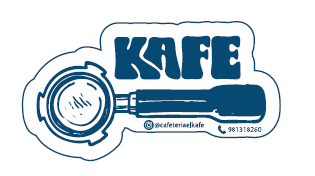

# Kafe Bar - Aplicación Web



## Descripción
Kafe Bar es una aplicación web moderna diseñada para la gestión y visualización de la carta de un bar/restaurante. Ofrece una experiencia interactiva y visualmente atractiva para los clientes.

## Características
- 🍽️ **Menú Interactivo:** Visualización dinámica de tapas, raciones y bebidas.
- 📱 **Diseño Responsive:** Optimizado para dispositivos móviles y tablets.
- 📄 **Cerrar Menú:** Versión imprimible y descarga en PDF.
- 🔥 **Firebase Integration:** Despliegue listo para Firebase Hosting.

## Tecnologías Utilizadas
- HTML5 / CSS3 (Vanilla)
- JavaScript (Vanilla)
- Firebase Hosting
- Worker para procesos en segundo plano

## Estructura del Proyecto
- `index.html`: Página principal.
- `css/`: Estilos de la aplicación.
- `js/`: Lógica cliente.
- `imagenes/`: Recursos visuales.
- `menu-printable.html`: Versión para impresión.

## Despliegue
La aplicación está configurada para desplegarse mediante Firebase:
```bash
firebase deploy
```

---
Desarrollado para **Kafe Bar**.
