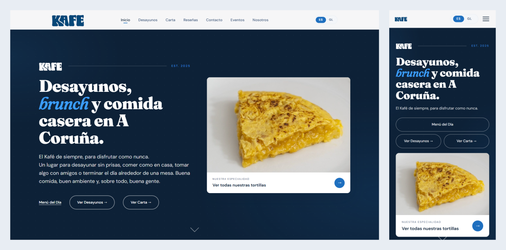
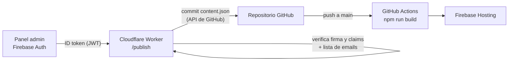

# Kafé — web para bar-restaurante

Web completa para **Kafé**, un bar-restaurante de A Coruña: diseño, desarrollo, panel de administración y despliegue automático. Proyecto personal hecho para un negocio real (02/2026 – 08/2026).

**Demo (entorno provisional):** https://kafe-143b5.web.app/



> Código publicado como muestra de portfolio. Ver [Derechos](#derechos).

## Qué hace

- **Web bilingüe (español / gallego)** con cambio de idioma sin recargar la página.
- **Carta, desayunos, menú del día y eventos** generados desde un único `content.json`.
- **Cartas imprimibles** (HTML optimizado para PDF) y **códigos QR** para las mesas.
- **Panel de administración** para que el propio negocio edite la carta y los textos sin tocar código.
- **Formulario de reservas** que envía un email al bar (implementado; pendiente de activar en la versión final).
- **SEO**: datos estructurados schema.org, `sitemap.xml` y Google Analytics 4.

## Arquitectura del panel de administración

La web es estática (sin servidor ni base de datos propios). Para que el negocio pueda editar contenido, el panel publica los cambios como un commit en GitHub y el pipeline de CI/CD reconstruye y despliega la web:



1. El usuario inicia sesión en `/admin` con Firebase Authentication.
2. Al publicar, el panel envía el contenido al Worker con el **ID token** del usuario.
3. El Worker **verifica el JWT a mano con WebCrypto** (sin librerías): firma RS256 contra las claves públicas de Google (cacheadas en el edge), `aud`, `iss`, `exp`, `iat` y `sub`.
4. Solo los emails de una **lista de permitidos** pueden publicar. Si la lista no está configurada, no publica nadie (*fail-closed*).
5. El Worker hace commit de `content.json` (y de las imágenes nuevas, validando sus rutas) mediante la API de GitHub.
6. GitHub Actions ejecuta el build y despliega en Firebase Hosting.

Detalle técnico del endpoint: [`worker/PUBLISH.md`](worker/PUBLISH.md).

## Stack

| Parte | Tecnología |
|---|---|
| Front-end | HTML5, CSS3, JavaScript (vanilla, sin frameworks) |
| Build | Node.js, script propio sin dependencias (`build.js`) |
| Panel admin | JavaScript + Firebase Authentication |
| API | Cloudflare Workers (publicación; reservas vía Resend pendientes de activar) |
| CI/CD | GitHub Actions |
| Hosting | Firebase Hosting (con cabecera Content-Security-Policy) |

## Build

`build.js` lee `content.json` y las plantillas de `templates/` y genera:

- `index.html`
- `menu-printable*.html` (cartas imprimibles)
- `js/translations.generated.js` (textos ES/GL para el cambio de idioma)

Si falta una clave en `content.json`, el build falla con un error explícito en lugar de publicar una web incompleta.

Los archivos generados no se versionan (están en `.gitignore`): `content.json` es la única fuente de verdad y GitHub Actions ejecuta el build en cada despliegue.

## Estructura

```
├── admin/            Panel de administración (login + editor de contenido)
├── css/              Estilos
├── js/               Lógica de la web (idioma, reservas, carruseles)
├── templates/        Plantillas HTML que usa el build
├── content.json      Todo el contenido editable de la web
├── build.js          Generador de HTML y traducciones
├── build.config.js   Mapeo de claves de traducción → content.json
├── worker/           Cloudflare Worker (/publish y reservas)
├── scripts/          Herramientas internas (QR, reseñas)
└── .github/          Workflows de despliegue
```

## Ejecutar en local

```bash
npm run build      # regenera los HTML desde content.json
npx serve .        # sirve la web en local
```

Worker (requiere cuenta de Cloudflare):

```bash
cd worker
npx wrangler dev
```

### Configuración

Los valores reales no están en el repositorio. Para desplegar una copia propia hay que sustituir los marcadores:

| Dónde | Marcador |
|---|---|
| `admin/admin.js` | `YOUR_FIREBASE_API_KEY`, `YOUR_FIREBASE_APP_ID`, `YOUR_MESSAGING_SENDER_ID`, URL del Worker |
| `js/script.js`, `firebase.json` (CSP) | `your-worker.your-account.workers.dev` |
| `worker/wrangler.toml` | `GITHUB_REPO`, `ALLOWED_PUBLISHER_EMAILS` |
| Secretos del Worker | `GITHUB_TOKEN`, `RESEND_API_KEY` (con `wrangler secret put`) |

## Tests

El Worker tiene tests con el runner nativo de Node, sin dependencias. Cubren la verificación real del JWT (RS256 con claves generadas en el test), la allowlist fail-closed, CORS, la validación de reservas y publicaciones, y el commit en GitHub con las APIs externas simuladas.

```bash
node --test "worker/*.test.mjs"
```

## Herramientas internas

- `scripts/generate-qr.js`: genera los códigos QR de la carta con el logo del bar.
- `scripts/scrape-reviews.js`: herramienta de uso interno que se usó para recopilar las reseñas públicas de Google Maps que se muestran en la web. Usa Playwright (`npx playwright install chromium` antes de ejecutarlo). La alternativa oficial sería la API de Google Places.

## Próximas mejoras

- Dividir `admin/admin.js` en módulos (autenticación, editor, publicación).
- Tests automáticos para `build.js`.
- Dominio propio.

## Derechos

El código se publica únicamente como muestra de portfolio. **Todos los derechos reservados.**

El nombre, la marca, el logotipo, las fotografías y los contenidos de Kafé pertenecen al negocio y no pueden reutilizarse.

Autor: [Manuel Carro Suárez](https://www.linkedin.com/in/manuelcarro)
