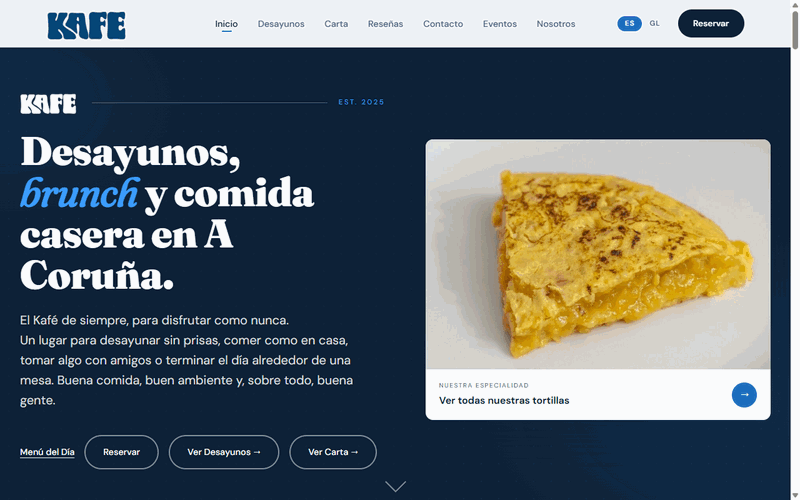
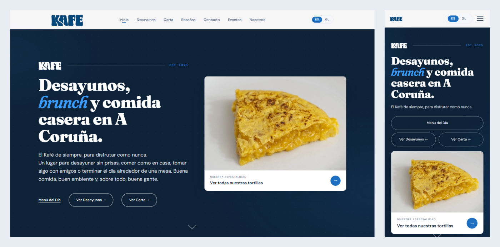
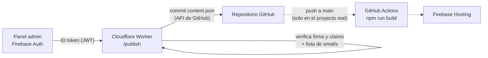
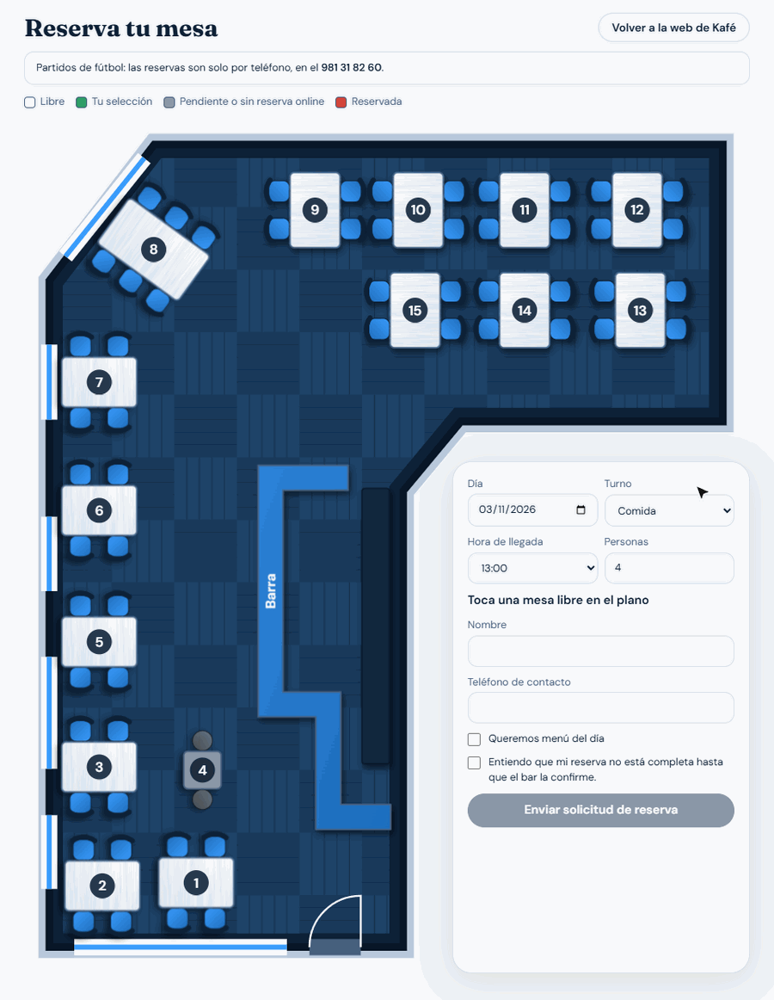
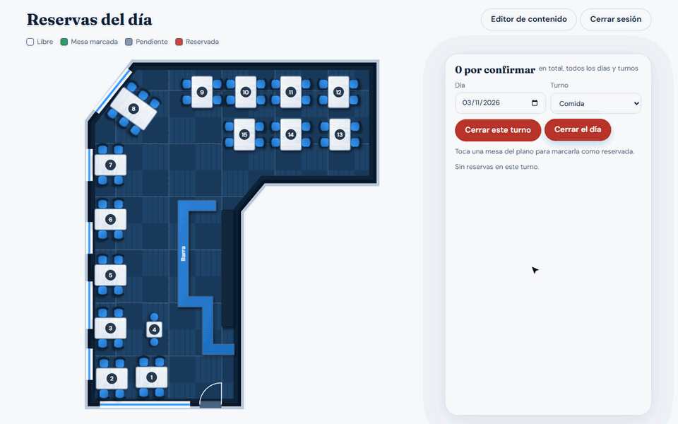

# Kafé — web para bar-restaurante

Web completa para **Kafé**, un bar-restaurante de A Coruña: diseño, desarrollo, panel de administración, publicación de contenido sin tocar código y módulo de reservas. Proyecto personal hecho para un negocio real (02/2026 – 08/2026).

**Demo (entorno provisional):** https://kafe-143b5.web.app/





> Código publicado como muestra de portfolio. Ver [Derechos](#derechos).

## Qué hace

- **Web bilingüe (español / gallego)** con cambio de idioma sin recargar la página.
- **Carta, desayunos, menú del día y eventos** generados desde un único `content.json`.
- **Cartas imprimibles** (HTML optimizado para PDF) y **códigos QR** para las mesas.
- **Panel de administración** para que el propio negocio edite la carta y los textos sin tocar código.
- **Reservas online con plano de mesas**, panel para el bar y aviso por email (ver [Reservas](#reservas)). Implementado y probado, pero el cliente decidió no activarlo.
- **SEO**: datos estructurados schema.org, `sitemap.xml` y Google Analytics 4.

## Arquitectura del panel de administración

La web es estática (sin servidor ni base de datos propios). Para que el negocio pueda editar contenido, el panel publica los cambios como un commit en GitHub. En el proyecto real, un workflow de CI/CD reconstruía y desplegaba la web con cada commit (ver paso 6):



1. El usuario inicia sesión en `/admin` con Firebase Authentication.
2. Al publicar, el panel envía el contenido al Worker con el **ID token** del usuario.
3. El Worker **verifica el JWT a mano con WebCrypto** (sin librerías): firma RS256 contra las claves públicas de Google (cacheadas en el edge), `aud`, `iss`, `exp`, `iat` y `sub`.
4. Solo los emails de una **lista de permitidos** pueden publicar. Si la lista no está configurada, no publica nadie (*fail-closed*).
5. El Worker hace commit de `content.json` (y de las imágenes nuevas, validando sus rutas) mediante la API de GitHub.
6. En el proyecto real, GitHub Actions ejecutaba el build y desplegaba en Firebase Hosting. Esos workflows de despliegue no se incluyen aquí porque apuntaban al proyecto del cliente.

Detalle técnico del endpoint: [`worker/PUBLISH.md`](worker/PUBLISH.md).

## Reservas

Módulo de reservas online con plano de mesas, pensado para que el bar gestione las solicitudes sin llamadas. El cliente lo descartó antes de activarlo, así que queda como muestra del trabajo. La lógica está en `worker/reservas/` y se prueba con Vitest.

- **Plano de mesas** (`/reservas/`): el cliente elige día, turno, hora y mesas sobre un plano de 15 mesas. Las ocupadas se ven en el plano; en móvil el plano es plegable.
- **Turnos y reglas** (`worker/reservas/rules.js`, funciones puras): comida y cena con franjas de 15 minutos, hasta 30 días de antelación y 1 hora de margen mínimo. Lunes a jueves solo hay comida, viernes y sábado comida y cena, y el domingo cerrado salvo que el bar lo abra. Solo se pueden juntar ciertas parejas de mesas, cada selección admite un rango de personas y los grupos grandes se derivan a llamada.
- **Reservas pendientes**: la solicitud queda *pendiente* hasta que el bar la confirma. Si no, caduca (lo primero entre 24 h o 2 h antes de llegar, con mínimo de 30 min) y la mesa se libera.
- **Sin dobles reservas**: un índice único parcial en D1 impide que dos reservas activas ocupen la misma mesa, turno y día aunque lleguen a la vez.
- **Panel del bar** (`/admin/reservas/`, mismo login de Firebase que el editor): vista del día con el plano, confirmar o liberar reservas, crear reservas a mano, avisos de pendientes y mensajes de WhatsApp al cliente.
- **Cierres**: se puede cerrar un día entero o un solo turno, y abrir un domingo concreto.
- **Antibots y privacidad**: Cloudflare Turnstile verificado en el Worker (falla cerrado), límite de reservas pendientes por teléfono y un cron horario que borra los datos personales de las reservas ya pasadas con más de 30 días. El email al bar no incluye nombre ni teléfono; esos datos solo se ven en el panel.
- **Avisos por email** con Resend al recibir una reserva. Sin `RESEND_API_KEY` o sin `MAIL_TO` no se envía nada.
- **Preview aislado**: `js/api-config.js` elige el Worker según el host (local, canal de preview o producción); el preview usa su propia base D1 y tiene desactivado el botón de publicar.



El cliente elige día, turno, hora y mesas; la solicitud queda pendiente de confirmación.


El bar ve las reservas del día sobre el plano, las confirma o las libera y puede crear una a mano.



Cierre de un turno o de un día entero: el plano deja de aceptar reservas en ese turno o en todo el día, y se puede volver a abrir.

## Stack

| Parte | Tecnología |
|---|---|
| Front-end | HTML5, CSS3, JavaScript (vanilla, sin frameworks) |
| Build | Node.js, script propio sin dependencias (`build.js`) |
| Panel admin | JavaScript + Firebase Authentication |
| API | Cloudflare Workers (publicación y reservas), D1 (SQLite), Resend, Turnstile |
| Tests | `node:test` y Vitest (`@cloudflare/vitest-plugin`) |
| CI | GitHub Actions (tests) |
| Hosting | Firebase Hosting (con cabecera Content-Security-Policy) |

## Build

`build.js` lee `content.json` y las plantillas de `templates/` y genera:

- `index.html`
- `menu-printable*.html` (cartas imprimibles)
- `js/translations.generated.js` (textos ES/GL para el cambio de idioma)

Si falta una clave en `content.json`, el build falla con un error explícito en lugar de publicar una web incompleta.

Los archivos generados no se versionan (están en `.gitignore`): `content.json` es la única fuente de verdad y el build se ejecuta en cada despliegue.

## Estructura

```
├── admin/            Panel de administración (login + editor de contenido)
│   └── reservas/     Panel de reservas del bar
├── reservas/         Página pública de reservas con plano
├── privacidad/       Información de privacidad (borrador)
├── css/              Estilos
├── js/               Lógica de la web (idioma, plano de mesas, carruseles)
├── templates/        Plantillas HTML que usa el build
├── content.json      Todo el contenido editable de la web
├── build.js          Generador de HTML y traducciones
├── build.config.js   Mapeo de claves de traducción → content.json
├── worker/           Cloudflare Worker (/publish y reservas)
│   ├── reservas/     Reglas, acceso a D1, rutas de la API y email
│   ├── migrations/   Esquema de D1
│   └── test/         Tests de Vitest
├── scripts/          Herramientas internas (QR, reseñas) y test de api-config
└── .github/          Workflow de tests
```

## Ejecutar en local

```bash
npm run build      # regenera los HTML desde content.json
npx serve .        # sirve la web en local
```

Worker (requiere cuenta de Cloudflare):

```bash
cd worker
npx wrangler d1 migrations apply kafe-reservas --local   # crea las tablas en la D1 local
npx wrangler dev                                          # http://localhost:8787
```

Para probar las reservas en local, `worker/.dev.vars` necesita además:

```ini
RESERVAS_ABIERTAS=true                                     # en wrangler.toml está a "false"
DEV_ORIGIN=http://localhost:3000                           # origen de `npx serve .`, para CORS
TURNSTILE_SECRET_KEY=1x0000000000000000000000000000000AA   # clave de pruebas de Cloudflare (siempre pasa)
```

En `localhost`, `js/api-config.js` ya apunta a `http://localhost:8787` y usa la site key de pruebas de Turnstile.

### Configuración

Los valores reales no están en el repositorio. Para desplegar una copia propia hay que sustituir los marcadores:

| Dónde | Marcador |
|---|---|
| `admin/firebase-config.js` | `YOUR_FIREBASE_API_KEY`, `YOUR_FIREBASE_APP_ID`, `YOUR_MESSAGING_SENDER_ID`, `your-firebase-project`, `G-XXXXXXXXXX` |
| `admin/admin.js` | URL del Worker (`your-worker.your-account.workers.dev`) |
| `js/api-config.js` | URLs de los Workers (`your-worker...`, `your-worker-preview...`) y `YOUR_TURNSTILE_SITE_KEY` |
| `js/script.js` | `your-worker.your-account.workers.dev` |
| `firebase.json` (CSP) | `your-worker...`, `your-worker-preview...`, `your-firebase-project` |
| `.firebaserc`, `robots.txt`, `sitemap.xml`, `content.json` (`site`) | `your-firebase-project` |
| `templates/index.template.html` | ID de Google Analytics (`G-XXXXXXXXXX`) |
| `worker/index.js` | `your-firebase-project` en `ALLOWED_ORIGIN`, `ALLOWED_PUBLISH_ORIGIN_RE` (CORS) y `FIREBASE_PROJECT_ID` (`aud` del token) |
| `worker/reservas/mail.js` | `DEFAULT_PANEL_URL` (enlace al panel en el email) |
| `worker/wrangler.toml` | `GITHUB_REPO`, `ALLOWED_PUBLISHER_EMAILS`, `MAIL_TO`, `PANEL_URL` (preview), `YOUR_D1_DATABASE_ID` (`wrangler d1 create`) y `RESERVAS_ABIERTAS` (interruptor) |
| Secretos del Worker | `GITHUB_TOKEN`, `RESEND_API_KEY`, `TURNSTILE_SECRET_KEY` (con `wrangler secret put`) |
| `worker/.dev.vars` (local, ignorado por git) | Los mismos secretos para `wrangler dev`, más `RESERVAS_ABIERTAS` y `DEV_ORIGIN` (ver [Ejecutar en local](#ejecutar-en-local)) |

## Tests

Hay dos grupos de tests.

**`node:test`** (runner nativo de Node, sin dependencias). Cubren la verificación real del JWT (RS256 con claves generadas en el test), la allowlist fail-closed, CORS, la validación de reservas y publicaciones, y el commit en GitHub con las APIs externas simuladas. También hay un test del helper `js/api-config.js` (Worker según el host).

```bash
node --test "worker/*.test.mjs"
node --test scripts/api-config.test.mjs
```

**Vitest** con `@cloudflare/vitest-plugin`, para el módulo de reservas: reglas de mesas y turnos, acceso a D1 (con migraciones aplicadas en una base local de test), API pública (Turnstile y Resend simulados) y API del panel protegida con Firebase Auth.

```bash
cd worker
npm ci
npm test
```

En GitHub Actions (`.github/workflows/test.yml`) corren los dos grupos: `node:test` (Worker y `api-config`) y Vitest.

## Herramientas internas

- `scripts/generate-qr.js`: genera los códigos QR de la carta con el logo del bar.
- `scripts/scrape-reviews.js`: herramienta de uso interno que se usó para recopilar las reseñas públicas de Google Maps que se muestran en la web. Usa Playwright (`npx playwright install chromium` antes de ejecutarlo). La alternativa oficial sería la API de Google Places.

## Próximas mejoras

- Dividir `admin/admin.js` en módulos (autenticación, editor, publicación).
- Tests automáticos para `build.js`.
- Dominio propio.

## Derechos

El código se publica únicamente como muestra de portfolio. **Todos los derechos reservados.**

El nombre, la marca, el logotipo, las fotografías y los contenidos de Kafé pertenecen al negocio y no pueden reutilizarse.

Autor: [Manuel Carro Suárez](https://www.linkedin.com/in/manuelcarro)
